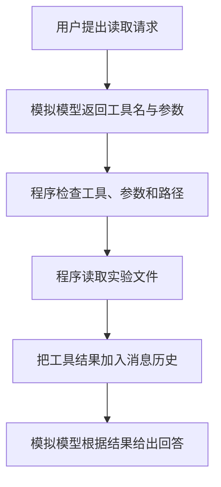

# 第一课：一次工具调用是怎样完成的

今天只要能够回答：模型提出请求之后，究竟是谁打开文件、谁检查参数、结果又交给谁。
本课不使用真实模型，不联网，不产生 API 费用。

本课代码是为学习项目单独编写的教学实验。Codex 与本机 claw-code 将作为后续源码对照教材，
当前实验尚未进入它们的源码精读。详见 [教材来源](../../docs/learning-sources.md) 和 [本课学习记录](learning-log.md)。

## 先认识三个角色

| 角色 | 本课对应的代码 | 工作 |
| --- | --- | --- |
| 模型 | `MockModel.reply()` | 返回“想调用什么工具”，接收工具结果后再给出回答 |
| 工具 | `read_file` 的执行逻辑 | 读取实验目录中的 UTF-8 文本 |
| 执行程序 | `run_demo()` 与 `execute_tool()` | 传递消息，检查工具与参数，执行读取，回传结果 |

工具可以理解为程序向模型提供的一项能力。模型输出工具名，不会让这个工具自动运行。
Harness 中的执行代码必须接住请求，并决定是否、怎样执行。



这次实现覆盖工具分发、参数校验和结果回传。持续循环、真实模型和状态恢复会在后续课程中加入。

## 第一步：运行参考实验

打开 PowerShell，逐行执行：

```powershell
Set-Location -LiteralPath 'D:\python\File of python\Harness开发'
& .\.venv\Scripts\python.exe -X utf8 -m mini_harness.lesson01 --workspace .\lessons\01_tool_call\workspace
```

终端应显示五个阶段，最后一行包含：

```text
[5 模型给出回答] 文件内容：今天的目标：看懂模型、工具和执行程序之间的数据流。
```

`-X utf8` 让本次 Python 运行使用 UTF-8，便于在 Windows 终端中显示中文。
`note.txt` 位于本课的 `workspace` 目录中。程序只是读取它，不会修改它。
注意：这里的模型回复完全由代码预先写好；它能运行不代表我们已经验证了真实大模型的能力。

## 第二步：对照输出理解数据

第 2 步中，模拟模型返回的请求类似下面这个 Python 字典：

```python
{
    "id": "call_001",
    "name": "read_file",
    "arguments": {"path": "note.txt"},
}
```

- `name` 是工具名字，程序用它查找可以执行的工具。
- `arguments` 是工具的输入参数；本课的 `path` 指定要读的文件。
- `id` 是这次调用的标识，工具反馈通过 `tool_call_id` 与它对应。

这是本课自定义的简化消息格式，不是某家模型厂商完整 API 的实现。

消息历史 `messages` 是一个列表，依次放入用户请求、模型的工具请求、工具结果和模型回答。
`append()` 的作用是向列表末尾添加一条记录。

第 4 步把工具结果装进 `role="tool"` 的消息，才能在下一次 `model.reply(messages)` 时交回模拟模型。
`json.dumps()` 把 Python 字典转换成文本，`json.loads()` 再把这种文本还原成 Python 数据。

## 第三步：按这个顺序读代码

主文件：`mini_harness/lesson01.py`，测试文件：`test_lesson01.py`。

1. 先读 `run_demo()`，对照五条终端输出，找到数据传递的顺序。
2. 再读 `MockModel.reply()`，确认它只是返回字典，没有打开文件。
3. 最后读 `execute_tool()`，找到 `target.open("rb")`；实际读取文件发生在这里。
4. 查看读取之前的 `isinstance(...)`、`set(arguments)` 和 `strip()` 检查：它们要求恰好一个 `path` 参数，且值为非空白字符串。

这里保留学习目录中已有的 Python 显式参数校验实现。`isinstance` 检查类型，`set(arguments)`
检查参数名，`strip()` 用来判断字符串去掉空白后是否还有内容。现在先理解“先校验，再执行”。
Pydantic 参数模型会作为后续对照练习。

路径检查和大小限制已经提供，帮助实验只接触指定目录中的小文件。第一遍可以先跟踪正常流程，第二遍再看检查失败时怎样返回。

## 第四步：观察错误情况

在项目目录运行：

```powershell
& .\.venv\Scripts\python.exe -X utf8 -m pytest -q
```

其中覆盖三个本课重点：

| 输入情况 | 程序应怎样处理 |
| --- | --- |
| `read_file`，参数为 `{"path": "note.txt"}`，文件存在 | 读取并返回内容 |
| `read_file`，参数为 `{"path": 123}` | 返回 `invalid_arguments`，不打开文件 |
| `delete_file` 等未注册工具 | 返回 `unknown_tool`，不执行请求 |

测试还检查目录越界、文件不存在、文件过大、编码错误和反馈回传。
通过表示这些预先设计的检查通过，并不保证程序应对了所有可能情况。

## 第五步：你亲手完成的练习

1. 运行演示与测试，保留终端输出；参考实现已由助手验证，你仍需自己运行一遍。
2. 用自己的话写出这六步：用户请求 → 模型提出调用 → 程序检查 → 工具执行 → 结果回传 → 模型回答。
3. 可选：只修改 `workspace/note.txt` 的内容，再运行演示，观察最终回答跟随文件内容变化。
4. 读 `test_invalid_arguments_are_rejected_before_reading` 与 `test_unknown_tool_is_rejected`，指出哪一个检查发生在参数校验之前。

本课不用补全所有安全细节，也不要求独立重写整个文件。先能够解释主流程，再逐渐自己实现。

## 时间安排与完成标准

建议用 20 分钟理解三个角色、20 分钟运行实验、35 分钟对照代码、25 分钟看测试和改动文本、20 分钟复盘。
如果对字典、函数或列表还不熟悉，先停在正常流程，把疑问带回聊天。

完成标准：你能指出真正读取文件的那一行，解释错误参数为何不会触发读取，并说明为何必须把工具结果再次交给模型。
