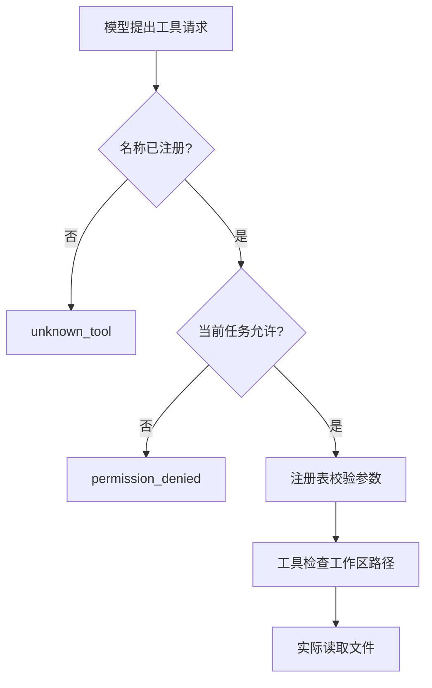

# 第 7 天：注册工具以后，还要检查本次是否允许

目标：区分“工具不存在”“工具存在但没有许可”“参数错误”和“路径越界”，
并证明拒绝发生在实际读取之前。前置：第 2 天的注册表，第 3 天的结果回传。

## 25 分钟：先想清楚谁决定许可

注册表解决“这个名字对应哪个函数”。任务许可解决“当前任务能否使用这个函数”。
本课把注册表中的 `read_file`、`count_lines` 都保留，但宿主配置只允许 `read_file`。
`count_lines` 也是只读工具；这里故意禁止它，便于观察许可与注册是两个判断。

许可集合在程序创建任务时传入，不从模型的工具参数中读取。
模型在消息中写“我已获授权”不能改变这份集合。



参数或路径检查失败时，也会返回错误并停止。图中的顺序对应本课代码，
不是所有 Harness 都必须采用的统一协议。

## 55 分钟：运行、定位、自己写

```powershell
Set-Location -LiteralPath 'D:\python\File of python\Harness开发'
& .\.venv\Scripts\python.exe -X utf8 -m mini_harness.lesson07 --scenario allowed
& .\.venv\Scripts\python.exe -X utf8 -m mini_harness.lesson07 --scenario denied
& .\.venv\Scripts\python.exe -X utf8 -m mini_harness.lesson07 --scenario unknown
```

先预测再核对：

| 场景 | 请求 | 预期结果 | 是否进入实际工具函数 |
| --- | --- | --- | --- |
| allowed | read_file | ok: true | 是 |
| denied | count_lines | permission_denied | 否 |
| unknown | delete_file | unknown_tool | 否 |

这里没有注册或执行删除工具。错误场景演示仍会正常结束，进程退出码为 0；
工具结果中的 `ok: false` 表示请求被拒绝。

再比较另外两层检查：

```powershell
& .\.venv\Scripts\python.exe -X utf8 -m mini_harness.lesson07 --scenario invalid
& .\.venv\Scripts\python.exe -X utf8 -m mini_harness.lesson07 --scenario traversal
```

两次都请求有许可的 `read_file`，但结果分别是 `invalid_arguments` 和 `path_not_allowed`。
允许某个工具以后，参数和路径检查仍然生效。

打开 `mini_harness/lesson07.py`，只跟踪 `PolicyRegistry.dispatch()`：
第一次 `return` 拒绝未知工具，第二次拒绝未许可工具，最后才委托给原注册表。
`frozenset` 保存一份不可变快照，避免外部原集合后来被修改，悄悄扩大本次许可。
注册表应在创建这层包装之前配置完成。

接着填写 `exercises/day07_starter.py` 的 `permission_code()`。
它只做判断，不执行工具。先处理未知名字，再检查许可，最后返回 `allowed`。

## 20 分钟：证明拒绝后没有执行

```powershell
& .\.venv\Scripts\python.exe -X utf8 -m pytest .\exercises\check_day07.py -q
& .\.venv\Scripts\python.exe -X utf8 -m pytest .\test_lessons07_09.py -k denied_request -q
```

自己完成函数后，第一条应为 **4 passed**；第二条应为 **1 passed**。
第二条参考测试注册了一个记录调用的假 handler：如果被调用，就在列表里留下记录。
测试既检查 `permission_denied`，也检查列表仍为空。只检查错误码，无法发现“先执行再报错”。

最后看错误如何交回模型：

```powershell
& .\.venv\Scripts\python.exe -X utf8 -m mini_harness.lesson07 --scenario loop
```

预期是 `model_finished`，模型调用 3 次、工具调用尝试 2 次；最终回复说明 `count_lines` 被拒绝。
这里的 `model_finished` 只表示模型停止回答，不能据此认定任务成功。
工具计数包括被拒绝的请求，实际 handler 只执行了读文件那一次。

## 20 分钟：复盘与源码对照

复习集合中的 `in`、`not in` 和不可变对象。口头回答：

1. 注册和许可分别解决什么问题？
2. 从给模型展示的工具列表里去掉一个名字，为什么执行入口仍需要检查？
3. `read_file` 获得许可后，为什么不能读取 `../outside.txt`？

可选读 [claw-code 权限分支定位](source-reading.md)，只看权限拒绝发生在读取之前。
本课按名称许可，不能限制 CPU、网络或同一用户下其他进程；它还没有成为系统级沙箱。

完成标准：

- [ ] 能解释四种不同错误属于哪一层。
- [ ] 自己的函数通过 4 项检查。
- [ ] 能用“调用记录为空”说明拒绝后没有执行 handler。
- [ ] 在学习日志中写下 `model_finished` 与任务成功的区别。

聊天入口：“我在第 7 天。count_lines 已注册却被拒绝，我认为原因是……请检查。”
